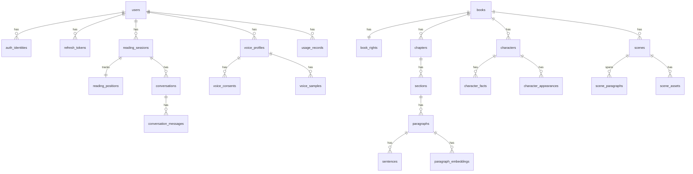

# Database Design

> PostgreSQL 18 + pgvector 0.8.6. ORM: SQLAlchemy 2 (async). 마이그레이션: Alembic.
> ✅ = Phase 1에서 구현됨 · 나머지는 표시된 Phase에서 구현

## 1. 원칙

1. **모든 사용자 소유 테이블에 `user_id`**를 두고, repository 메서드는 `user_id`를 필수 인자로 받는다 (다른 사용자 데이터 조회 경로 차단). 운영에서 Row Level Security 도입은 Phase 12에서 검토한다.
2. PK는 UUID (`uuid4`). 순서가 필요한 곳은 PK에 의존하지 않고 **명시적 순번 컬럼**을 쓴다.
3. 시간은 전부 `timestamptz` (UTC).
4. 원문 순서는 `global_seq` (책 전체에서 단조 증가 정수)로 표현한다 → 스포일러 필터·진행률·재개의 기준이다.
5. 삭제: 사용자 데이터는 DB 레벨 `ON DELETE CASCADE`를 쓴다. 외부 리소스(provider의 voice, S3 객체)는 DB cascade로 지울 수 없으므로 **삭제 작업 큐**를 거친다.
6. 문자열 SQL 조합 금지. 모든 쿼리는 SQLAlchemy 표현식/바인딩 파라미터로 작성한다.

## 2. ERD (요약)



## 3. 테이블

### 3.1 계정·보안 (Phase 1 ✅)

**users ✅**
| 컬럼 | 타입 | 비고 |
|---|---|---|
| id | uuid PK | |
| email | varchar(320) UNIQUE NULL | 소문자 정규화. Apple "Hide my email"은 relay 주소 |
| email_verified_at | timestamptz NULL | 이메일 인증은 Phase 12 |
| password_hash | varchar NULL | argon2id. 소셜 전용 계정은 NULL |
| display_name | varchar(80) NULL | |
| status | varchar(16) | `active` / `suspended` |
| created_at / updated_at | timestamptz | |

**auth_identities ✅** — 소셜 로그인 연결
| id, user_id FK CASCADE, provider (`apple`/`google`), subject (provider의 sub), email_at_link, created_at |
UNIQUE(provider, subject)

**refresh_tokens ✅** — rotating refresh token
| 컬럼 | 비고 |
|---|---|
| id uuid PK | |
| user_id FK CASCADE | |
| family_id uuid | 로그인 1회 = family 1개. 재사용 탐지 시 family 전체 폐기 |
| token_hash char(64) UNIQUE | SHA-256(토큰). 원문 저장 안 함 |
| expires_at, created_at | |
| revoked_at NULL, replaced_by_id NULL | 회전 이력 |
| user_agent varchar(200) NULL | 기기 목록 표시용 (IP는 저장하지 않음) |

**audit_logs ✅**
| id, actor_user_id uuid **(FK 없음)**, action (`auth.login`, `auth.refresh_reuse_detected`, `user.deleted` 등), target_type, target_id, metadata jsonb(민감정보 금지), created_at |
FK를 두지 않는 이유: 계정 삭제 후에도 감사 기록이 남아야 한다. 보존기간이 지나면 파기한다 ([security.md](security.md#retention)).

### 3.2 책 (Phase 2 ✅)

**books**: id, title, author, language(`ko`), cover_asset_id, status(`draft`/`processing`/`ready`/`failed`), processing_version, total_paragraphs, total_sentences, created_at

**book_rights**: book_id PK/FK, rights_type(`public_domain`/`licensed`/`owned`), rights_holder, license_start, license_end, commercial_use bool, **audio_rights bool, ai_processing_rights bool**, territory, contract_ref, verified_by, verified_at
→ `audio_rights`, `ai_processing_rights`가 없으면 ingestion을 거부한다. `license_start`/`license_end`는 **계약 시간대**(`RIGHTS_TIMEZONE`, 기본 Asia/Seoul)의 날짜로 판정한다(`story_core.books.rights.rights_today`). UTC로 판정하면 만료 후 최대 9시간 노출된다. 요구안 필드에 **이 2개를 추가**한 이유는 R1 참고.

**chapters**: id, book_id, sequence, title, first_sentence_seq, sentence_count
**sections**: id, book_id, chapter_id, sequence, title NULL
**paragraphs**: id, book_id, chapter_id, section_id, sequence(chapter 내), **global_seq (book 내 UNIQUE)**, text, text_hash, char_count, first_sentence_seq, sentence_count, scene_break_before, scene_id NULL(FK는 Phase 8)
**sentences**: id, paragraph_id, book_id, sentence_index(paragraph 내), **global_seq**, text, text_hash, char_start, char_end

> 구현 시 추가: 장·문단의 `first_sentence_seq`/`sentence_count`(클라이언트가 장 단위로만 받아도 진행률·전역 문장 번호 계산), `scene_break_before`(원문의 `***`·`<hr>` 보존 → Scene Engine 신호), `books`의 처리 상태 컬럼(`status`, `processing_version`, `processing_error` 코드, `source_*`). `sentences.index`는 예약어 충돌을 피해 `sentence_index`로 바꿨다.

인덱스: `paragraphs(book_id, global_seq)`, `sentences(book_id, global_seq)`, `sentences(paragraph_id, index)` UNIQUE.

### 3.3 RAG (Phase 4 ✅)

**paragraph_embeddings** ✅: id, book_id, paragraph_id, chapter_id, chunk_index, start_global_seq, **end_global_seq**, text, content_hash, model_id, embedding `vector(1024)`, created_at
- UNIQUE `(book_id, model_id, chunk_index)` · 인덱스 `(book_id, end_global_seq)`(스포일러 필터가 매 질문 읽는다) · `(model_id, content_hash)`(재임베딩 회피) · HNSW `vector_cosine_ops` · GIN trigram(text)
- 문서 원안은 모델별 테이블명(`paragraph_embeddings_{model_key}`)이었다. **차원이 다른 모델은 새 테이블 + 백필 + 전환**이라는 원칙은 그대로 두되(컬럼 폭은 마이그레이션에 고정), 테이블명을 동적으로 만들지 않아 "모델 = 마이그레이션 스키마" diff 검사를 유지한다. `model_id`는 한 테이블 안에서 같은 차원의 모델을 구분하고 잘못된 모델로 인덱싱된 행을 찾기 위한 컬럼이다.
- `paragraph_id`/`chapter_id`에 FK가 없는 이유는 `audio_assets`와 같다: 재처리로 내용 행이 바뀌어도 같은 텍스트의 벡터는 다시 살 필요가 없다.
- SQLite(로컬 테스트)에서는 같은 컬럼이 JSON 배열이 되고 검색은 정확 스캔으로 돌아간다 — 안전이 걸린 쿼리를 DB 서비스 없이 검증하기 위한 것이다.

- 모델 교체 시 새 테이블에 재임베딩 → 검증 후 전환 → 옛 테이블 삭제. 한 컬럼에 여러 차원을 섞지 않는다.
- HNSW 인덱스 (`vector_cosine_ops`). pgvector `vector` 타입 HNSW는 2,000차원까지이며, 넘으면 `halfvec`을 쓴다.
- chunk는 **문단 경계를 넘지 않는다**. 스포일러 필터를 `end_global_seq`로 정확히 걸기 위해서다.

**스포일러 필터 쿼리 형태** <a id="spoiler-query"></a>

```sql
SELECT chunk_id, text, embedding <=> :q AS distance
FROM paragraph_embeddings_bge_m3
WHERE book_id = :book_id
  AND end_global_seq <= :reader_global_seq          -- NO_SPOILER
ORDER BY embedding <=> :q
LIMIT :k;
```

HNSW + 필터 조합은 필터가 강하면 recall이 떨어진다. 책 초반 위치(허용 chunk가 적을 때)에서 결과가 부족하면 pgvector 0.8의 iterative index scan(`hnsw.iterative_scan`)을 켜거나 exact scan으로 fallback한다. 책 1권의 chunk 수는 수천 개 수준이므로 exact scan도 비용이 작다 → **실측 후 결정**.

**키워드 검색:** PostgreSQL 기본 full-text에는 한국어 형태소 분석이 없다. 1차는 `pg_trgm`(인물명·고유명사 검색), 필요 시 형태소 분석 후 토큰 컬럼 + BM25를 도입한다. 벡터와 키워드는 RRF로 합친다.

### 3.4 캐릭터·Scene (Phase 8)

**characters**: id, book_id, canonical_name, aliases text[], bible_version int
**character_facts**: id, character_id, kind(`appearance`/`hair`/`clothing`/`body_type`/`age`/`trait`/`relationship`), value, **revealed_at_seq**, source_sentence_id, confidence
→ Character Bible은 **`revealed_at_seq <= reader_seq`인 fact만** 모아서 만든다 (스포일러 방지). 이미지 생성용 bible은 책 전체 fact를 쓰되, 결말을 드러내는 외형 변화는 scene 시점 기준으로 자른다.
**character_appearances**: character_id, scene_id, role(`main`/`present`/`mentioned`)
**scenes**: id, book_id, sequence, start_global_seq, end_global_seq, location, time_of_day, weather, mood, emotion, actions jsonb, characters jsonb, visual_style, description, image_prompt, analysis_version, boundary_score
**scene_paragraphs**: scene_id, paragraph_id (문단이 scene 경계에 걸리는 경우 대비. 기본은 1문단 1scene)
**scene_assets**: id, scene_id, image_asset_id, style, character_bible_version, prompt_hash, model_id, status, is_active

### 3.5 독서 세션 (Phase 2 ✅) <a id="positions"></a>

**reading_sessions**: id, user_id, book_id, voice_profile_id NULL(기본 목소리), spoiler_mode(`NO_SPOILER`/`LIGHT_SPOILER`/`FULL_SPOILER`), playback_state, speed, created_at, last_active_at, ended_at
UNIQUE(user_id, book_id) WHERE ended_at IS NULL — 책당 활성 세션 1개

**reading_positions**
| 컬럼 | 비고 |
|---|---|
| session_id PK/FK CASCADE | |
| chapter_id, paragraph_id (FK `SET NULL`), sentence_index | 재처리로 내용 행이 교체되면 NULL → worker가 `sentence_global_seq`로 재연결 |
| sentence_global_seq | 문장 global_seq (진행률·스포일러·재연결 기준) |
| scene_id NULL | |
| position_version bigint | 갱신마다 +1. `UPDATE ... WHERE position_version = :expected` |
| updated_by | `device:<id>` / `agent` |
| updated_at | |

**max_read_seq**를 별도로 둔다 (reading_sessions). 사용자가 뒤로 되감아도 **이미 읽은 범위**는 스포일러가 아니다. 필터 기준은 `max(현재 위치, max_read_seq)`다.

**users.role** ✅ (`reader`/`admin`) — 관리자 권한은 HTTP로 부여할 수 없고 `services/api/scripts/set_user_role.py`로만 변경(감사 로그 기록).

**conversations** ✅ (Phase 4): id, session_id, user_id, last_active_at, created_at
**conversation_messages** ✅: id, conversation_id, role(`user`/`assistant`), text, intent, position_global_seq, retrieval_refs jsonb(chunk id 목록), latency_ms jsonb(embed·search·llm·guard·total), provider, model, prompt_version, **guard_action**(`pass`/`blocked`/`provider_error`), created_at
→ 스포일러 불만이 들어오면 "그때 어디까지 들었고, 어떤 chunk로 답했고, 출력 검사가 무엇을 했는지"를 이 두 테이블로 재구성할 수 있어야 한다. 그래서 위치와 prompt 버전까지 함께 남긴다.
→ 보관기간 적용 대상 ([security.md](security.md#retention)). 학습 데이터 활용은 **별도 동의가 있을 때만**.

### 3.6 음성 (Phase 10)

**voice_profiles**: id, user_id, provider, provider_voice_id (암호화 컬럼), voice_version, status(`pending`/`ready`/`failed`/`deleting`/`deleted`), consent_status, quality_score, created_at, deleted_at
**voice_consents**: id, voice_profile_id, user_id, consent_text_version, consent_text_hash, script_id(본인 확인 낭독 문장), agreed_at, ip_hash NULL, app_version, revoked_at
**voice_samples**: id, voice_profile_id, storage_key (private bucket), duration_ms, sample_rate, quality jsonb, purge_after, purged_at

### 3.7 자산·캐시 (Phase 3 ✅ / 이미지 Phase 9)

**audio_assets** ✅: id, **cache_key char(64) UNIQUE**, kind(`sentence`/`paragraph`), book_id, paragraph_id, text_hash, voice_key(`voice@version`), voice_profile_id NULL, provider, model_version, format, sample_rate, duration_ms, byte_size, storage_key, timings jsonb(문단: 문장 타임스탬프), characters_billed, created_at, last_accessed_at

> `book_id`/`paragraph_id`에 **FK를 두지 않는다.** 책을 재처리하면 내용 행은 교체되지만 텍스트가 같은 오디오는 계속 유효해야 한다(캐시 키가 내용 기반). 대신 조회·삭제용 인덱스로 쓴다. `kind='sentence'` 행은 내부 빌딩 블록(WAV)이며 클라이언트에 노출하지 않는다.
> `characters_billed`는 **공급자를 실제로 호출한 행에만** 기록한다. 문단 행은 문장 오디오를 이어 붙인 결과이므로 항상 `0`이다 — 둘 다 기록하면 `SUM(characters_billed)`가 두 배가 되어 Phase 12 정산이 틀어진다. 캐시 적중은 새 행을 만들지 않으므로, 이 열의 합은 "공급자에 실제로 보낸 문자 수"와 정확히 일치한다.
→ `voice_profile_id`로 목소리 삭제 시 파생 오디오를 찾아 지운다.
**image_assets**: id, cache_key UNIQUE, storage_key, width, height, model_id, prompt_hash, safety_status, created_at

### 3.8 사용량·구독 (Phase 12)

**usage_records**: id, user_id NULL(시스템 작업), provider, model, request_type(`llm`/`embedding`/`stt`/`tts`/`voice_clone`/`image`), input_tokens, output_tokens, characters, audio_ms, image_count, estimated_cost_micros bigint, currency, session_id NULL, created_at
→ 월별 파티션. 사용자별 한도는 Redis 카운터로 판단하고 PG는 정산·분석용이다.
**provider_prices**: provider, model, unit, price_micros, effective_from — 비용 추정에 쓰며 코드에 가격을 하드코딩하지 않는다.
**subscriptions**: id, user_id, plan(`free`/`basic`/`premium`), store(`apple`/`google`), original_transaction_id, status, current_period_end, updated_at
**plan_limits**: plan, limit_key, value

### 3.9 학습 데이터 (Phase 13)

**training_examples**: id, source_message_id NULL, instruction, context, question, answer, book_type, scene, intent, quality(1–5), labeler, **consent_basis**, book_rights_ok bool, split(`train`/`eval`), created_at

## 4. 마이그레이션 규칙

- 모든 스키마 변경은 Alembic revision으로 한다. autogenerate 결과는 사람이 검토한다.
- Phase 1 테스트는 **ORM 메타데이터와 마이그레이션 결과가 일치하는지** 검사한다 (`tests/test_migrations.py`).
- 운영 배포는 expand → migrate → contract 순서로 한다 (컬럼 삭제는 코드 배포 이후 revision에서).
- `CREATE EXTENSION vector, pg_trgm`은 `infrastructure/postgres/init`과 첫 revision 양쪽에 있다 (managed DB에서는 init 스크립트가 실행되지 않기 때문).

## 5. 백업

Managed PostgreSQL PITR (7~35일) + 일일 스냅샷을 다른 리전에 보관한다. **분기마다 복원 리허설**을 한다. Redis는 백업 대상이 아니다 (PG에서 복구 가능한 데이터만 둔다).
