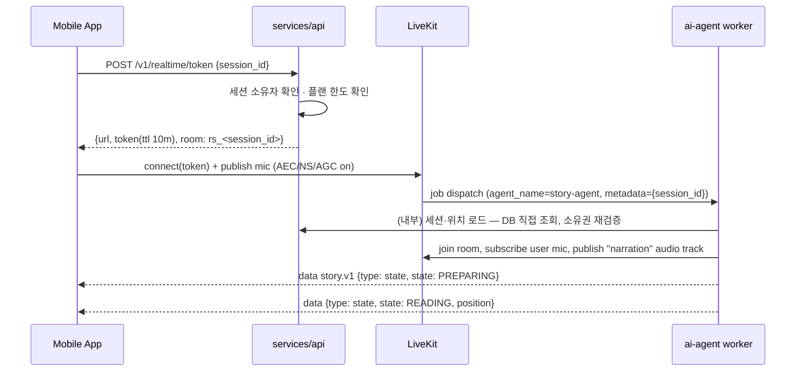

# Realtime Architecture — Talk 모드, Barge-in, Resume

> 상태: 설계 확정 (구현 Phase 5~7). 수치 목표는 **가설**이며 실측 후 조정한다.

## 1. 범위

이 문서는 **Talk 모드**(LiveKit 경유 실시간 대화)를 다룬다. Listen 모드(기기 로컬 재생)는 [mobile-architecture.md](mobile-architecture.md#audio)에 있다. 두 모드를 나눈 이유는 [architecture.md §3.2](architecture.md#32-모든-낭독을-livekit으로-흘리면-안-된다--재생-모드-2개)에 있다.

---

## 2. 연결 구조 (Phase 5 ✅) <a id="connection"></a>



### 2.1 토큰 권한 (최소 권한)

| 항목 | 값 | 이유 |
|---|---|---|
| room | `rs_{session_id}` | 세션당 room 1개. 다른 사용자와 room 공유 없음 |
| identity | `u_{user_id}` | agent가 참가자 구분 |
| canPublish | 마이크 소스만 | 사용자가 임의 비디오/화면 송출 불가 |
| canPublishData | true | 제어 명령 |
| canSubscribe | true | |
| roomAdmin / recorder | false | |
| TTL | 10분 (재연결은 새 토큰) | 탈취 시 피해 제한 |
| metadata | `session_id`만 | 개인정보·권한 정보를 토큰에 넣지 않는다. agent가 DB에서 재검증 |
| agent dispatch | 토큰의 room configuration에 explicit dispatch | 자동 dispatch 대신 명시적 dispatch로 agent 종류/버전 제어 |
| max_participants | 2 (독자 + agent) | 토큰이 유출돼도 제3자가 들어와 같이 들을 수 없다. 재연결은 같은 identity를 쓰므로 LiveKit이 교체한다 |
| empty_timeout | 60초 | 문서 §7의 재연결 grace와 같은 값 |

LiveKit API key/secret은 api와 agent 서버에만 둔다.

**확정된 SDK 필드명** (`livekit-api` 1.2.1, Phase 5에서 실제 서버로 확인):

```python
AccessToken(key, secret)
    .with_identity("u_<user_id>").with_metadata('{"session_id": "..."}')
    .with_ttl(timedelta(seconds=600))
    .with_grants(VideoGrants(room_join=True, room="rs_<session_id>",
                             can_publish=True, can_subscribe=True, can_publish_data=True,
                             can_publish_sources=["microphone"],     # 소문자 소스 이름
                             room_admin=False, recorder=False, hidden=False, agent=False))
    .with_room_config(RoomConfiguration(max_participants=2, empty_timeout=60,
                                        agents=[RoomAgentDispatch(agent_name="story-agent",
                                                                  metadata=...)]))
```

주의: agent worker 쪽 `WorkerPermissions.can_publish_sources`는 같은 값을 **protobuf enum**(`models.TrackSource.MICROPHONE`)으로 받는다. 토큰 grant와 어휘가 달라서, 소문자 문자열을 주면 publish가 아니라 **worker 등록**이 `unknown enum label "microphone"`으로 실패한다.

발급된 토큰은 실제 LiveKit 서버(1.13.7)에서 확인했다: room·identity·metadata가 설계대로 들어가고, 마이크 publish는 성공하고 **카메라 publish는 서버가 거부한다**.

### 2.2 Data channel 프로토콜 `story.v1`

JSON, reliable 전송. 모든 메시지는 `{v: 1, type, seq, ts}`를 포함한다. 알 수 없는 `type`은 무시한다 (앞으로 호환).

**Agent → App**

| type | payload | 용도 |
|---|---|---|
| `state` | `state`, `position{paragraph_id, sentence_index, position_version}` | UI 상태 표시 (읽는 중/듣는 중/생각 중/답변 중/다시 읽는 중) |
| `sentence` | `paragraph_id`, `sentence_index` | 하이라이트·자동 스크롤 |
| `scene` | `scene_id`, `image_url`(signed, 짧은 TTL) | 이미지 전환 |
| `transcript.partial` / `transcript.final` | `text` | 사용자 질문 자막 (저장 정책은 security.md) |
| `answer.delta` / `answer.done` | `text` | 답변 자막 |
| `error` | `code`, `retryable` | |

**App → Agent**

| type | payload | 설명 |
|---|---|---|
| `control` | `command`: `PAUSE` `RESUME` `ASK`(버튼 인터럽트) `SEEK_SENTENCE{delta}` `SEEK_PARAGRAPH{delta}` `STOP` | 상태 머신이 검증 후 적용 |
| `settings` | `speed`, `spoiler_mode` | |
| `client.playout` | `paragraph_id`, `sentence_index`, `buffer_ms` | (선택) 실제 재생 위치 보정 |

---

## 3. ReadingSession 상태 머신

LLM이 아니라 **순수 Python 상태 머신**(I/O 없음, 단위 테스트 대상)이 상태를 소유한다. I/O(오디오 정지, TTS 시작 등)는 전이 결과로 나오는 **effect 목록**을 agent가 실행한다.

### 3.1 상태

| 상태 | 의미 | UI |
|---|---|---|
| `IDLE` | 세션 없음/종료 | — |
| `PREPARING` | 위치 로드, 첫 오디오 준비 | 준비 중 |
| `READING` | 원문 낭독 중 | ● 읽는 중 |
| `USER_SPEAKING` | 사용자 발화 감지 (낭독 duck/정지) | ● 듣는 중 |
| `PROCESSING_QUESTION` | STT final → intent → RAG → LLM 첫 토큰 대기 | ● 생각 중 |
| `ANSWERING` | 답변 TTS 재생 중 | ● 답변 중 |
| `AWAITING_FOLLOWUP` | **추가 상태.** 답변 종료 후 후속 질문/"응"을 기다림 | ● 듣는 중 |
| `RESUMING` | 연결 멘트("그럼 다시 이야기할게") 재생, 재개 위치 준비 | ● 다시 읽는 중 |
| `PAUSED` | 사용자/시스템 일시정지 | 일시정지 |
| `ERROR` | 복구 불가 오류 (재시도 가능 여부 포함) | 오류 |

`AWAITING_FOLLOWUP`을 추가한 이유: 요구 UX에서 사용자가 "응"/"알겠어"라고 해야 재개된다. 이 대기 구간을 `READING`이나 `USER_SPEAKING`과 섞으면 "응"이 질문으로 처리되거나, 침묵 타임아웃 규칙을 둘 곳이 없다.

### 3.2 전이표 (핵심)

> **실행 가능한 명세는 `packages/story-core/story_core/reading/state_machine.py`와 그 테스트다** (Phase 2 ✅). 구현하며 보강한 점: `ANSWER_FAILED` 이벤트(→ 안내 cue 후 `AWAITING_FOLLOWUP`), 답변 중 끼어들기도 낭독과 같은 duck→확정 2단계, `CONTROL_PAUSE`는 대화 중 어느 상태에서나 허용, 짧은 안내 음성은 `PLAY_CUE(PARDON|LISTENING|ANSWER_FAILED)` effect. 저장된 Talk 모드 상태(에이전트 소실)는 `PAUSED @ 마지막 확정 문장`으로 복구된다(`snapshot_from_storage`). Listen 모드 API는 같은 머신을 `bridge_phrase=False`로 사용한다.

| From | Event | Guard | To | Effects |
|---|---|---|---|---|
| IDLE | `START` | 세션 로드 성공 | PREPARING | load position |
| PREPARING | `READY` | | READING | play from position |
| READING | `VAD_SPEECH_START` | | USER_SPEAKING | **duck narration**, mark interrupt point |
| READING | `CONTROL_ASK` (버튼) | | USER_SPEAKING | **stop narration**, mark interrupt point |
| READING | `SENTENCE_DONE` | | READING | checkpoint(position+1) |
| READING | `CONTROL_PAUSE` | | PAUSED | stop narration, persist |
| USER_SPEAKING | `INTERRUPT_CONFIRMED` (발화 ≥ min_duration 또는 STT 단어 ≥ min_words) | | USER_SPEAKING | **stop narration**, flush audio queue |
| USER_SPEAKING | `FALSE_INTERRUPTION` (타임아웃 내 의미 있는 발화 없음) | 낭독이 duck만 된 상태 | READING | unduck (위치 손실 없음) |
| USER_SPEAKING | `STT_FINAL` | intent ∈ {QUESTION, SCENE_QUESTION} | PROCESSING_QUESTION | build context, call LLM |
| USER_SPEAKING | `STT_FINAL` | intent = PLAYBACK_COMMAND | (명령에 따름) | apply command |
| USER_SPEAKING | `STT_FINAL` | intent = INTERRUPT_ONLY ("잠깐") | AWAITING_FOLLOWUP | — |
| PROCESSING_QUESTION | `ANSWER_FIRST_AUDIO` | | ANSWERING | publish answer audio |
| ANSWERING | `VAD_SPEECH_START` + confirmed | | USER_SPEAKING | stop answer (답변 끼어들기) |
| ANSWERING | `ANSWER_DONE` | | AWAITING_FOLLOWUP | start followup timer |
| AWAITING_FOLLOWUP | `STT_FINAL` | intent = ACK/RESUME ("응", "알겠어", "계속") | RESUMING | play bridge phrase |
| AWAITING_FOLLOWUP | `STT_FINAL` | intent = QUESTION | PROCESSING_QUESTION | |
| AWAITING_FOLLOWUP | `FOLLOWUP_TIMEOUT` | 설정값 (기본 4s, 실측 조정) | RESUMING | play bridge phrase |
| RESUMING | `BRIDGE_DONE` | | READING | play from resume point |
| PAUSED | `CONTROL_RESUME` | | RESUMING | |
| * | `FATAL` | | ERROR | persist last confirmed position |
| ERROR | `RETRY` | retryable | PREPARING | |

**불변식 (테스트로 강제):**
1. `interrupt_point`는 `READING`을 떠나는 순간 한 번만 기록되고, `RESUMING → READING` 전이에서만 소비된다.
2. 질문·답변 중에는 ReadingPosition이 바뀌지 않는다 (SEEK 명령 제외).
3. `ERROR`/크래시 복구 시 복귀 위치는 **마지막으로 확정된 문장**이다.
4. 정의되지 않은 (state, event) 조합은 예외가 아니라 **무시 + 경고 로그**다. 네트워크 이벤트는 순서가 뒤바뀌어 도착할 수 있다.

---

## 4. Barge-in 설계 <a id="bargein"></a>

### 4.1 경로

```text
사용자 발화 시작
 │  (마이크 → WebRTC AEC/NS → LiveKit → agent)
 ▼
agent VAD speech_start ───────────────► 낭독 즉시 duck (-12dB)       t0 + ~VAD 지연
 │                                         (위치 표시: interrupt_point)
 ▼
확정 조건 충족 (min_duration / 단어 수 / "잠깐" 키워드 partial)
 │───────────────────────────────────► 낭독 정지 + audio queue flush   ← "즉시 멈춤"
 ▼
STT final ─► IntentRouter ─► (QUESTION) ─► Retriever + ContextBuilder ─► LLM stream
                                                                          │ 절 단위 분할
                                                                          ▼
                                                               TTS stream ─► answer track
```

- **버튼 인터럽트**(`CONTROL_ASK`)는 확정 단계 없이 바로 정지한다. 오탐이 없는 경로이며, 시끄러운 환경의 fallback이다.
- **Duck → 확정 후 정지**의 2단계인 이유: 맞장구·기침·주변 소리마다 낭독이 완전히 멈추면 청취 경험이 망가진다. duck만 했다면 오탐일 때 위치 손실 없이 원래 볼륨으로 돌아간다.
- LiveKit Agents의 인터럽션 옵션(`min_duration`, `min_words`, `false_interruption_timeout`, `resume_false_interruption`)은 **LLM 발화용**으로 설계되어 있다. 낭독 트랙은 자체 `InterruptionManager`가 제어하고, 프레임워크 옵션을 재사용할 수 있는지는 Phase 7 spike에서 확인한다.

### 4.2 "사용자 음성을 놓치지 않는다"

- VAD `speech_start` 이전 **pre-roll 버퍼**(예: 300ms)를 STT 스트림에 함께 보낸다. 첫 음절("잠")이 잘리지 않게 한다.
- STT 스트림은 Talk 모드 동안 **계속 열어둔다** (발화마다 연결하면 연결 지연 + 첫 음절 손실). 비용이 문제면 VAD 게이트로 무음 프레임 전송만 줄인다.
- agent 오디오 publish 중에도 사용자 트랙 구독은 멈추지 않는다 (full duplex).

### 4.3 에코

- Talk 모드 낭독·답변은 모두 LiveKit 트랙으로 재생되므로 클라이언트 WebRTC AEC의 기준 신호에 포함된다.
- 블루투스 이어폰은 AEC가 필요 없지만 **HFP 전환으로 음질이 떨어진다** (A2DP ↔ HFP). 이어폰 연결 시 품질 저하 안내가 필요하다 — Phase 11 실기기 테스트 항목.
- 스피커 볼륨이 크고 기기 AEC 성능이 낮은 경우를 대비해, agent는 **자기 발화 중 STT 결과가 방금 낭독한 문장과 유사하면 무시**하는 보조 필터를 둔다 (텍스트 유사도).

### 4.4 목표 지연 (가설, 실측 후 확정)

**측정된 전송 왕복 (2026-09-16, 로컬 Docker LiveKit 1.13.7 + echo agent):** p50 **107 ms** · p95 157 ms · min 98 ms (8회). 이 값은 앱 → LiveKit → agent → LiveKit → 앱 전 구간이며, 아래 barge-in·응답 예산은 모두 이 위에 쌓인다. 실제 네트워크(LTE·Wi-Fi)에서는 이보다 커지므로 Phase 7 실측 때 다시 잰다.

> 측정 방법에서 걸린 함정: `rtc.AudioSource`는 기본 1초 버퍼를 갖고 `capture_frame()`은 **큐에 넣기만 하면** 반환한다. 무음 200 ms를 넣은 직후 시계를 시작하면 우리 큐 대기시간이 전송 지연으로 잡혀 303 ms가 나온다(3배 과대). 큐가 빈 것을 확인한 뒤 타이밍을 시작해야 한다.

| 구간 | 목표 p50 | 목표 p95 |
|---|---|---|
| 발화 시작 → duck | ≤ 250ms | ≤ 400ms |
| 확정 → 오디오 정지 (클라이언트 버퍼 포함) | ≤ 150ms | ≤ 300ms |
| 버튼 → 정지 | ≤ 150ms | ≤ 300ms |
| 발화 종료 → STT final | ≤ 500ms | ≤ 900ms |
| STT final → LLM 첫 토큰 (RAG 포함) | ≤ 700ms | ≤ 1200ms |
| LLM 첫 절 → TTS 첫 오디오 | ≤ 300ms | ≤ 600ms |
| **발화 종료 → 답변 첫 음성** | **≤ 1.5s** | **≤ 2.5s** |

`PROCESSING_QUESTION`이 1.2초를 넘으면 캐시된 짧은 필러("음, 그건...")를 재생하는 옵션을 둔다. A/B로 효과를 확인한다.

---

## 5. Streaming 처리 <a id="streaming"></a>

### 5.1 STT (Phase 6 ✅ 인터페이스·오프라인 구현)

```python
class STTProvider(Protocol):
    def stream(self, *, language: str, sample_rate: int) -> STTStream: ...

class STTStream(Protocol):
    async def push(self, pcm16_frame: bytes) -> None: ...      # 20ms mono PCM16
    async def end(self) -> None: ...
    def events(self) -> AsyncIterator[STTEvent]: ...           # partial | final | speech_start | error
    async def aclose(self) -> None: ...                        # 취소 시 즉시 upstream 종료
```

- 프레임 크기·샘플레이트 변환은 어댑터가 담당한다.
- partial은 intent 조기 판단(재생 명령 "멈춰" 등)에만 쓰고, 질문 답변은 final 기준이다.
- 오프라인 구현(`FakeSTTProvider`)은 **인식하지 않고 감지만 한다**: 프레임 에너지로 발화 시작·끝을 잡고 스크립트를 순서대로 내보낸다. 계정 없이 barge-in 트리거·partial 타이밍·에이전트 반응을 검증하기 위한 것이며 운영에서는 거부된다.
- 이벤트의 시각은 **밀어 넣은 오디오 길이**(`audio_ms`)로 센다. 벽시계에는 네트워크 지터가 섞여 "언제 말하기 시작했나"를 왜곡한다.

### 5.2 LLM → TTS (Phase 6 ✅ ClauseChunker)

```text
LLM token stream ──► ClauseChunker ──► SpoilerGuard ──► TTS ──► AudioFrame queue ──► LiveKit AudioSource
                     (문장부호·접속 어미·   (절마다 검사:      (answer.delta는
                      최대 길이 기준)       통과한 절만 방출)   재생 직전에 전송)
```

- 구현은 `QuestionService.ask_stream`이다. 텍스트 API의 `ask`와 준비 단계(스포일러 창 → 검색 → 컨텍스트)와 기록 단계를 공유하고, 생성 단계만 다르다. 그래서 음성 질문과 텍스트 질문의 스포일러 창·근거 기록이 갈라지지 않는다.
- **가드는 절마다, 방출 전에** 돌린다. 한 절이라도 걸리면 그 절은 내보내지 않고 모델 스트림을 닫은 뒤 안전 문구로 끝낸다. 이미 방출된 절은 이미 말한 것이니 그대로 두고, 기록에도 "실제로 방출된 절 + 안전 문구"가 남는다. 전체 답을 다 받은 뒤 한 번 검사하면 첫 음성이 생성 시간 전체만큼 늦어진다.
- `answer.delta`는 절 오디오를 **큐에 넣기 전에** 보낸다. `play()`는 큐가 차면 막히므로, 뒤에 보내면 자막이 소리보다 절 길이만큼 늦게 도착한다(E2E에서 실제로 2초 차이로 관측).

- 첫 청크는 짧게(첫 절), 이후 청크는 길게 보내 억양을 자연스럽게 한다. 구현은 종결부호와 연결어미(`~고`·`~지만`·`~는데`·`~해서`)를 경계로 쓰고, 경계가 없으면 문자 수 상한에서 공백을 찾아 끊어 지연을 묶는다.
- 경계는 버퍼 **전체**에서 찾는다. 끝만 검사하면 한 번에 긴 델타가 도착할 때 중간 경계를 놓치고 첫 음성이 늦어진다(구현 중 실제로 발생).
- **취소 전파:** barge-in 시 `asyncio.Task.cancel()` → LLM HTTP 스트림 close → TTS WebSocket close → AudioSource queue clear. provider contract test에 "취소 후 N ms 내 upstream 연결 종료"를 넣는다 ([provider-abstraction.md](provider-abstraction.md#cancellation)).
- 답변 텍스트는 끝까지 받지 못했어도 **실제로 재생된 부분까지만** 대화 기록에 남긴다. — Phase 7: 지금은 끝까지 간 답변만 기록한다(가드 차단·제공사 오류 포함). 끼어들어 끊긴 답변은 취소된 태스크 안에서 DB에 쓰는 문제와 "어디까지 들렸나"(`client.playout`)를 함께 풀어야 해서 barge-in과 같이 구현한다. 모델 스트림 종료는 이미 된다(`aclose` 전파, 테스트 있음).

### 5.3 낭독 (Talk 모드) — Phase 6 ✅

- 문장 오디오를 캐시에서 가져와 순서대로 AudioSource에 넣는다. 캐시 미스면 TTS를 lookahead로 생성한다 (구현: +2문장).
- 다음 위치는 **낭독 소스가 알려준다**(`SpokenSentence.following`). 세션이 "같은 문단, 인덱스+1"로 계산하면 문단 마지막 문장 뒤에서 존재하지 않는 위치가 되고, 그 조회가 빈 결과를 돌려줘 책이 끝난 것으로 처리됐다(E2E에서 첫 문단 끝에서 IDLE로 떨어짐). 소스는 한 행을 더 읽어 다음 위치만 얻고, 그 문장의 오디오는 만들지 않는다.
- agent 컨테이너는 worker가 렌더한 오디오 볼륨을 **읽기 전용으로** 마운트한다. 마운트가 없으면 캐시 키는 맞는데 파일이 없어 전부 다시 합성한다.
- 리더가 나가면 세션이 끝난다. SDK의 `AudioStream`은 상대가 나가도 끝나지 않으므로 `participant_disconnected`·`track_unsubscribed`·`disconnected`를 직접 보고 마이크 스트림을 닫는다. 그렇지 않으면 빈 방에 책 끝까지 낭독(=합성·LLM 비용)이 계속된다(E2E에서 실제로 25문장을 끝까지 읽음).
- **Phase 3의 문장 캐시를 그대로 읽는다**(`sentence_cache_key`). 같은 목소리·같은 문장이면 Listen 모드와 같은 오디오가 나오고, 합성비를 두 번 내지 않는다.
- `SENTENCE_DONE`은 **문장 단위로** 올린다. 배치 단위로 올리면 상태 머신의 위치가 들은 지점보다 최대 lookahead만큼 뒤처지고, 그 값이 곧 재개 위치가 된다(구현 중 실제로 발생).
- 큐는 500ms로 제한한다. 큐에 쌓인 오디오는 인터럽트가 걸려도 사용자가 이미 듣게 되는 분량이다.
- agent는 문장별 `(paragraph_id, sentence_index, 시작 프레임, 길이)`를 기록한다. 인터럽트 시각에서 클라이언트 재생 버퍼 추정치(`client.playout.buffer_ms`, 없으면 기본 120ms)를 빼서 **실제로 듣고 있던 문장**을 계산한다.

---

## 6. Resume 규칙

| 상황 | 재개 위치 |
|---|---|
| 문장 중간에서 끊김 | 그 **문장의 처음** |
| 문장이 시작된 지 < 400ms에 끊김 | 그 문장 처음 (이전 문장으로 가지 않음) |
| 문장 경계 ±150ms에서 끊김 | 다음 문장 처음 |
| 질문이 N분(기본 2분) 이상 이어짐 | 이전 **문장 1개 전**부터 (맥락 회복) — 설정값 |
| 사용자가 "처음부터 다시" | 현재 문단 처음 |

연결 멘트("그럼 다시 이야기할게", "이어서 읽어줄게" 등 3~5개 변형)는 **목소리별로 미리 생성해 캐시**한다. 재개 시 TTS 지연이 0이 된다.

---

## 7. 재연결과 복구 <a id="recovery"></a>

| 장애 | 동작 |
|---|---|
| 모바일 네트워크 순간 끊김 | LiveKit 클라이언트 자동 재연결. agent는 사용자 트랙이 사라지면 낭독을 `PAUSED`로 전이 (아무도 안 듣는 동안 낭독 진행 금지) |
| 재연결 성공 (grace 60s 이내) | 같은 agent job 유지, 사용자 확인 후 `RESUMING` |
| grace 초과 | agent가 위치를 PG에 저장하고 room 종료 → 다음 연결 시 새 job |
| agent 프로세스 크래시 | Redis 체크포인트(문장 경계마다) → 새 job이 로드, `PAUSED @ 마지막 확정 문장` |
| 앱 강제 종료 | 서버 위치(PG)와 로컬 위치 중 `position_version` 높은 쪽 채택, 차이가 크면 "다른 기기에서 여기까지 들었어요" 확인 |
| 배포(agent 재시작) | drain: 새 job 거부, 기존 세션은 문장 경계에서 체크포인트 후 종료 가능 |

**영속화 정책**

| 저장소 | 언제 | 무엇 |
|---|---|---|
| Redis `rs:{session_id}` | 문장 경계마다 | state, position, interrupt_point, position_version |
| PostgreSQL `reading_positions` | 5초 debounce + 상태 전이 + disconnect + PAUSE | position, position_version, updated_at |

---

## 8. 관측성: trace 지점

질문 1회 = trace 1개 (`interaction_id`). 각 지점은 span 이벤트 타임스탬프로 기록한다.

```text
speech_start → interrupt_confirmed → narration_stopped
→ stt_first_partial → stt_final → intent_decided
→ retrieval_start → retrieval_done
→ llm_start → llm_first_token → llm_done
→ tts_start → tts_first_audio → answer_first_played
→ answer_complete → followup_resolved → resume_start → reading_resumed
```

- 원문·질문 텍스트·오디오는 span 속성에 넣지 않는다. 길이, 토큰 수, 문자 수만 기록한다.
- 파생 지표: `interrupt_latency = narration_stopped - speech_start`, `response_latency = answer_first_played - stt_final`, false interruption 비율, 재연결 빈도.

---

## 9. 테스트 전략

| 테스트 | 방법 |
|---|---|
| 상태 전이 | 순수 단위 테스트 (전이표 전 경로 + 불변식 property test) |
| 인터럽트·재개 로직 | Fake STT/LLM/TTS + 가상 시계로 이벤트 시퀀스 재생 |
| 실시간 E2E | **Python 봇 클라이언트**가 room에 접속해 녹음된 한국어 질문 wav를 낭독 중 임의 시점에 publish → 정지 지연·재개 위치·응답 지연 측정 |
| 전송 왕복 (Phase 5 ✅) | `services/ai-agent/scripts/measure_roundtrip.py` — API에서 토큰을 받아 접속하고, 무음 뒤 임펄스 1프레임을 보내 echo agent가 돌려주기까지의 시간을 잰다 |
| 오탐 | 맞장구·기침·TV 소음 코퍼스로 false interruption 비율 측정 |
| 재연결 | 네트워크 차단 주입 (toxiproxy 등) |
| 실기기 | iOS/Android × 스피커/유선/블루투스 매트릭스 ([mobile-architecture.md](mobile-architecture.md#testing)) |
